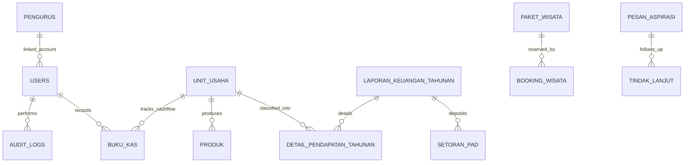

# Skema Database Relasional (MySQL) & Spesifikasi REST API
## BUMDes Sedya Makmur — Desa Mayong Lor, Kec. Mayong, Kab. Jepara

> **Status Dokumen**: Resmi (Telah Dikonfirmasi)  
> **Dasar Pendirian**: Peraturan Desa Mayong Lor No. 7 Tahun 2014 & Akta Notaris Mulung Estu No. 14 / C-493.HT.03.01-TH 2014  
> **Identitas Visual**: Cokelat Tua (`#4A2C17`), Terakota (`#B5532F`), Krem (`#FBF1E1`), Aksen Hijau (`#1E9E6A`)  
> **DBMS Sasaran**: MySQL 8.0+ (InnoDB Engine, utf8mb4_unicode_ci, ACID Compliant)

---

## 1. Arsitektur Relasi Basis Data (ERD)



---

## 2. Definisi Skema Tabel MySQL (Data DDL & Dictionary)

### 2.1. Modul Manajemen Pengguna & Tata Kelola
```sql
CREATE TABLE users (
    id BIGINT UNSIGNED AUTO_INCREMENT PRIMARY KEY,
    nik VARCHAR(16) NOT NULL UNIQUE,
    nama_lengkap VARCHAR(150) NOT NULL,
    email VARCHAR(120) NOT NULL UNIQUE,
    no_hp VARCHAR(20) NOT NULL,
    password_hash VARCHAR(255) NOT NULL,
    role ENUM(
        'superadmin',
        'direktur',
        'sekretaris',
        'bendahara',
        'pengawas_bpd',
        'manajer_unit',
        'staf_operasional'
    ) NOT NULL DEFAULT 'staf_operasional',
    status ENUM('active', 'inactive') NOT NULL DEFAULT 'active',
    last_login_at DATETIME NULL,
    created_at TIMESTAMP DEFAULT CURRENT_TIMESTAMP,
    updated_at TIMESTAMP DEFAULT CURRENT_TIMESTAMP ON UPDATE CURRENT_TIMESTAMP,
    INDEX idx_user_role (role)
) ENGINE=InnoDB DEFAULT CHARSET=utf8mb4 COLLATE=utf8mb4_unicode_ci;

CREATE TABLE audit_logs (
    id BIGINT UNSIGNED AUTO_INCREMENT PRIMARY KEY,
    user_id BIGINT UNSIGNED NOT NULL,
    action VARCHAR(50) NOT NULL COMMENT 'CREATE, UPDATE, DELETE, AUDIT, APPROVE',
    table_affected VARCHAR(80) NOT NULL,
    record_id BIGINT UNSIGNED NOT NULL,
    old_values JSON NULL,
    new_values JSON NULL,
    ip_address VARCHAR(45) NOT NULL,
    created_at TIMESTAMP DEFAULT CURRENT_TIMESTAMP,
    FOREIGN KEY (user_id) REFERENCES users(id) ON DELETE RESTRICT
) ENGINE=InnoDB DEFAULT CHARSET=utf8mb4 COLLATE=utf8mb4_unicode_ci;
```

---

### 2.2. Modul Kelembagaan & Pengurus
```sql
CREATE TABLE pengurus (
    id INT UNSIGNED AUTO_INCREMENT PRIMARY KEY,
    jabatan VARCHAR(100) NOT NULL COMMENT 'Direktur, Penasihat, Sekretaris, Bendahara, Pengawas',
    nama VARCHAR(150) NOT NULL,
    no_hp VARCHAR(25) NULL,
    foto_url VARCHAR(255) NULL,
    keterangan VARCHAR(255) NULL,
    urutan INT NOT NULL DEFAULT 1,
    is_active BOOLEAN NOT NULL DEFAULT TRUE,
    created_at TIMESTAMP DEFAULT CURRENT_TIMESTAMP,
    updated_at TIMESTAMP DEFAULT CURRENT_TIMESTAMP ON UPDATE CURRENT_TIMESTAMP
) ENGINE=InnoDB DEFAULT CHARSET=utf8mb4 COLLATE=utf8mb4_unicode_ci;
```

---

### 2.3. Modul 6 Unit Usaha
```sql
CREATE TABLE unit_usaha (
    id INT UNSIGNED AUTO_INCREMENT PRIMARY KEY,
    kode_unit VARCHAR(30) NOT NULL UNIQUE,
    nama_unit VARCHAR(150) NOT NULL,
    deskripsi TEXT NOT NULL,
    tahun_mulai INT NOT NULL DEFAULT 2016,
    highlight_badge VARCHAR(100) NULL,
    penanggung_jawab VARCHAR(150) NULL,
    is_active BOOLEAN NOT NULL DEFAULT TRUE,
    created_at TIMESTAMP DEFAULT CURRENT_TIMESTAMP,
    updated_at TIMESTAMP DEFAULT CURRENT_TIMESTAMP ON UPDATE CURRENT_TIMESTAMP
) ENGINE=InnoDB DEFAULT CHARSET=utf8mb4 COLLATE=utf8mb4_unicode_ci;

-- 6 Unit Usaha Resmi:
-- 1. SIMPAN_PINJAM (modal awal 25jt, berkembang ke 38jt, 50+ nasabah)
-- 2. BEKISTING (persewaan alat bekisting bangunan)
-- 3. SEMBAKO_HORTIKULTURA (supplier SPPG program Makan Bergizi Gratis)
-- 4. KANTIN_PABRIK (kantin PT. TBS Industrial Indo x UMKM Jatrasmol)
-- 5. GERABAH_ARSITEKTUR (kriya gerabah, genteng, bata tempel Mayong Lor)
-- 6. KETAHANAN_PANGAN (kambing etawa, sayur hidroponik, kebun terpadu)
```

---

### 2.4. Modul Produk (Harga Opsional)
```sql
CREATE TABLE produk (
    id BIGINT UNSIGNED AUTO_INCREMENT PRIMARY KEY,
    unit_id INT UNSIGNED NOT NULL,
    kategori ENUM('Peternakan', 'Hortikultura', 'Gerabah & Arsitektur', 'Lainnya') NOT NULL,
    nama_produk VARCHAR(180) NOT NULL,
    deskripsi TEXT NOT NULL,
    harga DECIMAL(15, 2) NULL COMMENT 'NULL jika harga opsional / tanyakan harga via WhatsApp',
    satuan VARCHAR(50) NULL COMMENT 'liter, kg, bibit, buah, pcs',
    foto_url VARCHAR(255) NULL,
    stok_tersedia INT NULL,
    is_aktif BOOLEAN NOT NULL DEFAULT TRUE,
    created_at TIMESTAMP DEFAULT CURRENT_TIMESTAMP,
    updated_at TIMESTAMP DEFAULT CURRENT_TIMESTAMP ON UPDATE CURRENT_TIMESTAMP,
    FOREIGN KEY (unit_id) REFERENCES unit_usaha(id) ON DELETE RESTRICT,
    INDEX idx_kategori (kategori)
) ENGINE=InnoDB DEFAULT CHARSET=utf8mb4 COLLATE=utf8mb4_unicode_ci;
```

---

### 2.5. Modul Paket Wisata Edukasi
```sql
CREATE TABLE paket_wisata (
    id INT UNSIGNED AUTO_INCREMENT PRIMARY KEY,
    nama_paket VARCHAR(150) NOT NULL,
    deskripsi TEXT NOT NULL,
    durasi VARCHAR(50) NULL COMMENT 'Placeholder GANTI',
    min_peserta INT NULL COMMENT 'Placeholder GANTI',
    harga_per_orang DECIMAL(12, 2) NULL,
    fasilitas JSON NULL,
    is_aktif BOOLEAN NOT NULL DEFAULT TRUE,
    created_at TIMESTAMP DEFAULT CURRENT_TIMESTAMP,
    updated_at TIMESTAMP DEFAULT CURRENT_TIMESTAMP ON UPDATE CURRENT_TIMESTAMP
) ENGINE=InnoDB DEFAULT CHARSET=utf8mb4 COLLATE=utf8mb4_unicode_ci;
```

---

### 2.6. Modul Laporan Keuangan per Tahun & Setoran PAD
```sql
CREATE TABLE laporan_keuangan_tahunan (
    id INT UNSIGNED AUTO_INCREMENT PRIMARY KEY,
    tahun INT NOT NULL UNIQUE,
    total_pendapatan DECIMAL(15, 2) NOT NULL DEFAULT 0.00,
    total_pengeluaran DECIMAL(15, 2) NOT NULL DEFAULT 0.00,
    laba_bersih DECIMAL(15, 2) NOT NULL DEFAULT 0.00,
    setoran_pad_realisasi DECIMAL(15, 2) NOT NULL DEFAULT 0.00,
    status_audit ENUM('Draft', 'Audited', 'Ditetapkan_Musdes') NOT NULL DEFAULT 'Audited',
    catatan_sumber VARCHAR(255) NULL,
    file_laporan_pdf_url VARCHAR(255) NULL,
    created_at TIMESTAMP DEFAULT CURRENT_TIMESTAMP,
    updated_at TIMESTAMP DEFAULT CURRENT_TIMESTAMP ON UPDATE CURRENT_TIMESTAMP
) ENGINE=InnoDB DEFAULT CHARSET=utf8mb4 COLLATE=utf8mb4_unicode_ci;

CREATE TABLE detail_pendapatan_tahunan (
    id BIGINT UNSIGNED AUTO_INCREMENT PRIMARY KEY,
    laporan_id INT UNSIGNED NOT NULL,
    unit_id INT UNSIGNED NOT NULL,
    realisasi_pendapatan DECIMAL(15, 2) NOT NULL DEFAULT 0.00,
    keterangan VARCHAR(200) NULL,
    FOREIGN KEY (laporan_id) REFERENCES laporan_keuangan_tahunan(id) ON DELETE CASCADE,
    FOREIGN KEY (unit_id) REFERENCES unit_usaha(id) ON DELETE RESTRICT
) ENGINE=InnoDB DEFAULT CHARSET=utf8mb4 COLLATE=utf8mb4_unicode_ci;
```

---

### 2.7. Modul Pesan & Aspirasi Publik
```sql
CREATE TABLE pesan_aspirasi (
    id BIGINT UNSIGNED AUTO_INCREMENT PRIMARY KEY,
    nama VARCHAR(150) NOT NULL,
    kontak VARCHAR(100) NOT NULL COMMENT 'WhatsApp / Email',
    pesan TEXT NOT NULL,
    status ENUM('baru', 'diproses', 'selesai', 'diarsipkan') NOT NULL DEFAULT 'baru',
    respon_admin TEXT NULL,
    created_at TIMESTAMP DEFAULT CURRENT_TIMESTAMP,
    updated_at TIMESTAMP DEFAULT CURRENT_TIMESTAMP ON UPDATE CURRENT_TIMESTAMP
) ENGINE=InnoDB DEFAULT CHARSET=utf8mb4 COLLATE=utf8mb4_unicode_ci;
```

---

## 3. Spesifikasi REST API Endpoint

### 3.1. Endpoint Publik (Tanpa Autentikasi)
| Metode | Endpoint | Deskripsi |
|---|---|---|
| `GET` | `/api/v1/public/profil` | Mengambil data visi, misi, legalitas pendirian, dan kontak resmi |
| `GET` | `/api/v1/public/pengurus` | Mengambil struktur pengurus BUMDes |
| `GET` | `/api/v1/public/unit-usaha` | Mengambil 6 daftar unit usaha BUMDes Sedya Makmur |
| `GET` | `/api/v1/public/produk` | Filter produk berdasarkan kategori |
| `GET` | `/api/v1/public/paket-wisata` | Mengambil 3 paket wisata edukasi desa |
| `GET` | `/api/v1/public/transparansi` | Mengambil tabel laporan keuangan per tahun & proyeksi PAD |
| `GET` | `/api/v1/public/warta` | Mengambil artikel warta desa (hanya jika ada) |
| `POST` | `/api/v1/public/aspirasi` | Mengirim pesan / pertanyaan / pesanan publik |

### 3.2. Endpoint Admin Internal (Bearer Token JWT)
| Metode | Endpoint | Deskripsi |
|---|---|---|
| `POST` | `/api/v1/auth/login` | Login NIK & Password kedinasan |
| `GET` | `/api/v1/admin/dashboard` | Ringkasan KPI, total produk, dan mutasi buku kas |
| `GET/POST` | `/api/v1/admin/produk` | CRUD Produk katalog |
| `PUT/DELETE`| `/api/v1/admin/produk/:id` | Edit dan hapus produk |
| `GET/POST` | `/api/v1/admin/transparansi` | CRUD Laporan Keuangan Tahunan & Setoran PAD |
| `GET` | `/api/v1/admin/aspirasi` | Membaca daftar pesan warga masuk |
| `PUT` | `/api/v1/admin/aspirasi/:id` | Update status tindak lanjut aspirasi |
